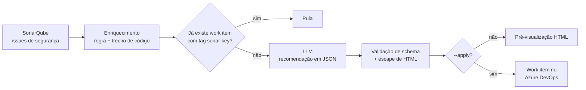

# sonar-ado-ai-triage

Triagem de vulnerabilidades do **SonarQube** com **LLM** e abertura automática de work items no **Azure DevOps**,
com a recomendação de correção no corpo da task.



## Por que existe

Em AppSec, cada issue do Sonar vira o mesmo trabalho manual: entender a regra, olhar o código, escrever como
corrigir e abrir uma task para o time. Este projeto automatiza esse ciclo e deixa o analista revisando,
não digitando.

## Destaques técnicos

| Tema | Como foi tratado |
|------|------------------|
| **Spec Driven Development** | Requisitos, critérios de aceite e decisões em [`specs/001-triagem-sonar-ado.md`](specs/001-triagem-sonar-ado.md); cada critério tem um teste correspondente. |
| **Saída estruturada** | O LLM responde em JSON; a resposta é validada antes de virar task. Resposta inválida vira falha registrada, sem derrubar o lote. |
| **Prompt injection** | Código e regra entram delimitados como dados, e o prompt de sistema manda ignorar instruções contidas neles. O demo inclui um comentário malicioso no código para testar isso. |
| **XSS** | Todo texto vindo do Sonar ou do LLM é escapado antes de compor o HTML do work item. |
| **Custo de tokens** | Entrada truncada, cache em disco por hash de (modelo + regra + trecho) e cache de prompt no prompt de sistema. O relatório final mostra tokens gastos e chamadas evitadas. |
| **Idempotência** | Tag `sonar-key:<chave>` + consulta WIQL antes de criar: rodar duas vezes não duplica tasks. |
| **Humano no controle** | Simulação por padrão; só cria com `--apply`. A ferramenta MCP de criação também exige `confirmar=True`. |
| **Agentes de IA (MCP)** | [`triage/mcp_server.py`](triage/mcp_server.py) expõe listar issues, recomendar correção e criar work item como ferramentas MCP. |

## Como rodar

```bash
python -m venv .venv && source .venv/bin/activate   # Windows: .venv\Scripts\activate
pip install -r requirements.txt

# 1) Demo: fluxo completo com dados fictícios, sem credenciais e sem rede
python -m triage --demo          # gera output/demo/*.html

# 2) Com seus dados: copie .env.example para .env e preencha
python -m triage --limit 5       # simulação: gera output/*.html
python -m triage --limit 5 --apply

# Testes
pytest -q
```

### Usando como ferramenta de um agente (MCP)

```json
{
  "mcpServers": {
    "sonar-triage": { "command": "python", "args": ["-m", "triage.mcp_server"] }
  }
}
```

## Estrutura

```
specs/            especificação (fonte da verdade do comportamento)
triage/
  sonar.py        cliente da API do SonarQube (issues, regras, código)
  llm.py          prompt, provedores (Anthropic / offline), validação e cache
  render.py       título e HTML do work item (com escape)
  azure_devops.py WIQL + criação de work item (JSON Patch)
  pipeline.py     orquestração e relatório
  mcp_server.py   ferramentas MCP para agentes
  demo.py         dados fictícios
tests/            um teste por critério de aceite
```

## Privacidade

O trecho de código vai para o provedor de LLM configurado. Antes de usar com código proprietário, confirme a
política da sua empresa sobre envio de código a provedores externos (ou aponte para um provedor aprovado
implementando a interface `LLMProvider`).

## Roadmap

- Fechar ou comentar o work item quando a issue for resolvida no Sonar.
- Atribuir área/time automaticamente com base no histórico de commits.
- Eval da qualidade das recomendações com um conjunto de issues rotuladas.
